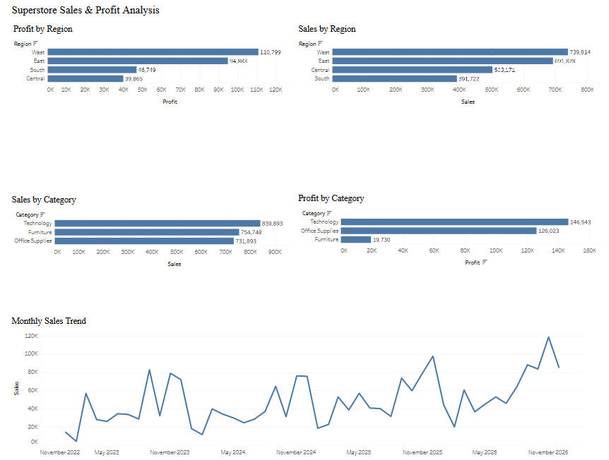

# Superstore Sales & Profit Analysis

## Overview
An interactive Tableau dashboard analyzing Superstore sales, profitability, regional performance, product categories, and monthly sales trends.

## Tools
- Tableau Public
- Data visualization
- Sales and profitability analysis

## Dashboard

[View Interactive Tableau Dashboard](https://public.tableau.com/views/Project_4_Tableau_17916458019900/SuperstoreSalesProfitDashboard)

## Analysis
- Sales by Region
- Profit by Region
- Sales by Category
- Profit by Category
- Monthly Sales Trend

## Business Insights
- The West region generated the highest sales and profit.
- Technology led product categories in both sales and profit.
- Furniture had substantially lower profit than Technology and Office Supplies.
- Monthly sales fluctuated significantly, highlighting the importance of monitoring sales trends.

## Project Goal
Demonstrate practical Tableau dashboard development, business performance analysis, and the ability to communicate findings through interactive visualizations.

